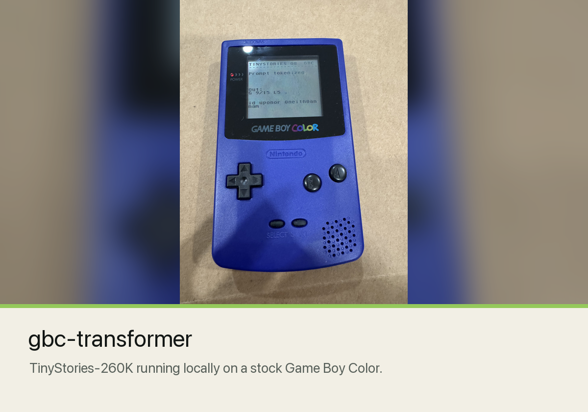
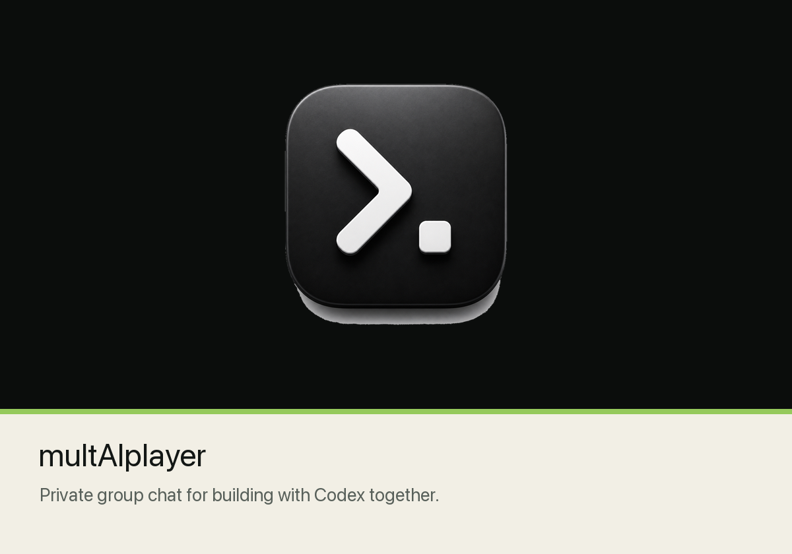
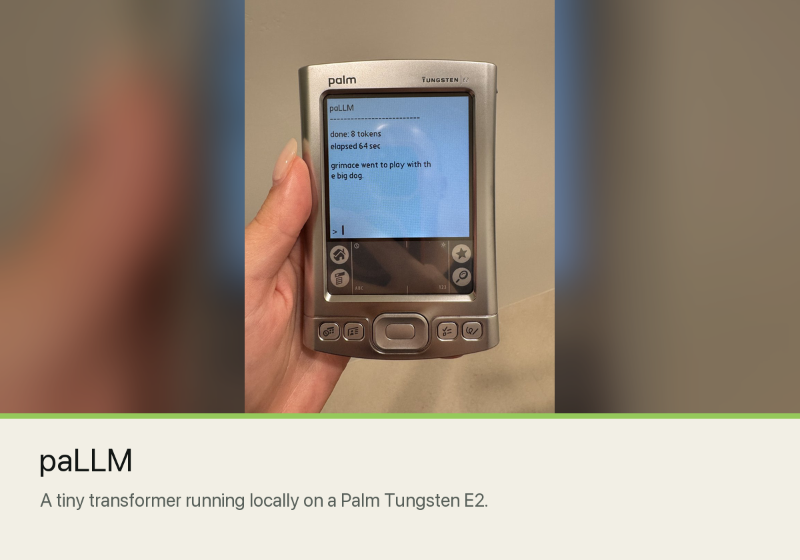
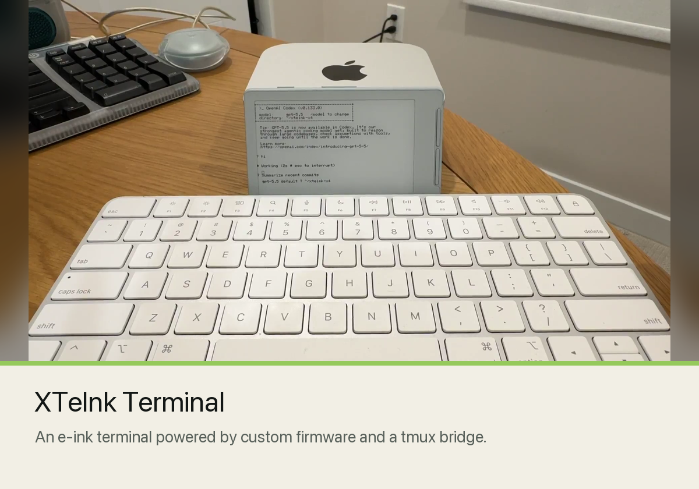
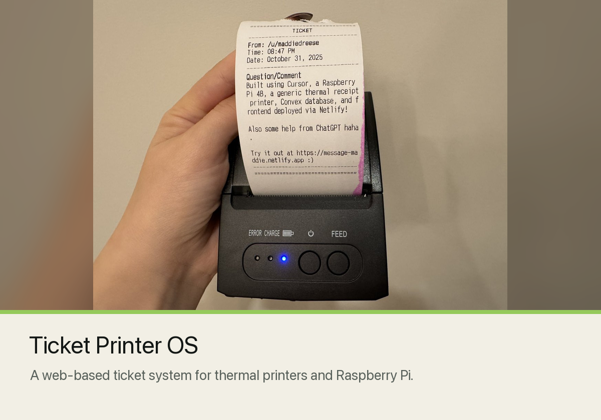
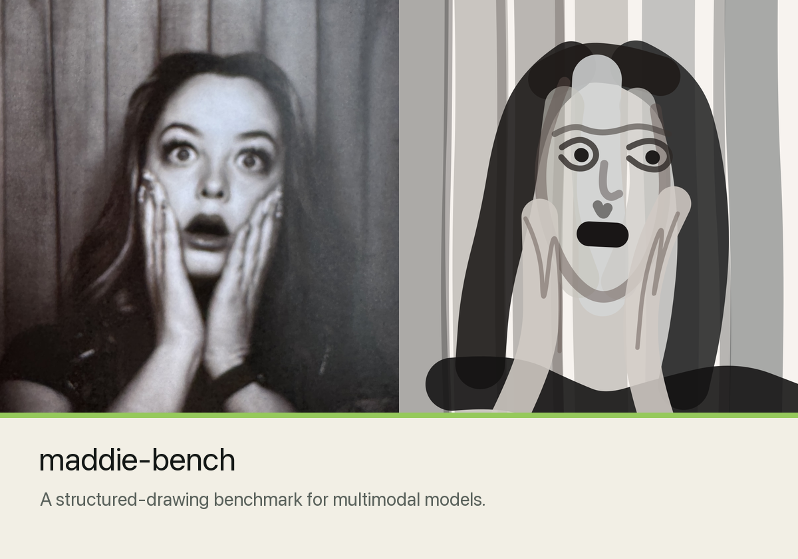

<h1 align="center">Maddie D. Reese</h1>

  I build strange, working AI systems with tiny models, old hardware, and physical interfaces, then explain how they work.

  <a href="https://maddiedreese.com">Website</a> &nbsp;|&nbsp;
  <a href="https://x.com/maddiedreese">X</a> &nbsp;|&nbsp;
  <a href="https://www.youtube.com/@maddiedreese">YouTube</a> &nbsp;|&nbsp;
  <a href="https://www.linkedin.com/in/maddiedreese">LinkedIn</a>

## Selected work

<table>
  <tr>
    <td width="50%">
      
    </td>
    <td width="50%">
      
    </td>
  </tr>
  <tr>
    <td width="50%">
      
    </td>
    <td width="50%">
      
    </td>
  </tr>
  <tr>
    <td width="50%">
      
    </td>
    <td width="50%">
      
    </td>
  </tr>
</table>

## What I build

My projects make technical systems visible. I run language models where they barely fit, give AI tools unfamiliar screens and controls, turn APIs into physical objects, and publish the implementation details so other people can inspect, use, and remix the work.

My background is in education and community building. I care about approachable tools, clear mental models, playful demos, and helping technically curious people become more technical through AI-assisted creation.

## Current experiments

Right now I am exploring local models, constrained inference, collaborative coding agents, retro hardware, e-ink interfaces, and public evaluations.

For more, visit [maddiedreese.com](https://maddiedreese.com).
